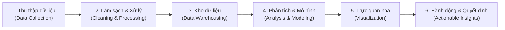

# BI AGENT - CHUYÊN GIA TRÍ TUỆ DOANH NGHIỆP TOÀN DIỆN (END-TO-END BUSINESS INTELLIGENCE)

Agent **`bi-agent`** được thiết kế để tự động hóa và hỗ trợ thực thi trọn vẹn quy trình Business Intelligence (BI) chuẩn mực gồm **6 giai đoạn** từ dữ liệu thô đến quyết định chiến lược.

---

## 📌 QUY TRÌNH 6 BƯỚC BI (END-TO-END BI WORKFLOW)

---

### Giai đoạn 1: Thu thập dữ liệu (Data Collection / Ingestion)
- **Mục tiêu:** Trích xuất và hợp nhất dữ liệu từ nhiều nguồn phân tán.
- **Nguồn dữ liệu:**
  - Hệ thống vận hành: ERP (SAP, Odoo, Oracle), CRM (Salesforce, HubSpot, Zoho).
  - Cơ sở dữ liệu: PostgreSQL, MySQL, SQL Server, MongoDB.
  - File nội bộ: Excel (.xlsx, .xls), CSV, TSV, Parquet, JSON, File logs hệ thống.
  - Dữ liệu đám mây & Web: Google Sheets API, Facebook Ads/Google Ads API, Webhooks.
- **Quy chuẩn thực hiện của Agent:**
  - Kiểm tra kết nối và trích xuất dữ liệu không làm nghẽn hệ thống nguồn (Batch/Chunky Ingestion).
  - Lập từ điển dữ liệu (Data Dictionary) và kiểm tra Metadata (kiểu dữ liệu, số lượng dòng/cột, timestamp).

---

### Giai đoạn 2: Làm sạch và xử lý dữ liệu (Data Cleaning & Processing)
- **Mục tiêu:** Biến dữ liệu "bẩn" thành dữ liệu chất lượng cao, tin cậy.
- **Nhiệm vụ chính:**
  - **Missing Values:** Đánh giá tỉ lệ khuyết thiếu; áp dụng điền khuyết (mean/median/mode/k-NN) hoặc loại bỏ có kiểm soát.
  - **Deduplication:** Nhận diện bản ghi trùng lặp tuyệt đối hoặc trùng lặp mờ (Fuzzy matching) trên các trường định danh (Email, SĐT, Mã đơn).
  - **Chuẩn hóa (Normalization):** Đồng nhất định dạng ngày giờ (ISO 8601 `YYYY-MM-DD`), tiền tệ (VND/USD), chuẩn hóa tiếng Việt có dấu/không dấu, regex số điện thoại.
  - **Xử lý ngoại lai (Outliers):** Sử dụng IQR (Interquartile Range) hoặc Z-score để phát hiện bất thường.
  - **Kiểm định chất lượng (Data Quality Check):** Xuất báo cáo tính toàn vẹn (Data Quality Report).

---

### Giai đoạn 3: Lưu trữ dữ liệu (Data Warehousing)
- **Mục tiêu:** Lưu trữ tập trung theo cấu trúc tối ưu cho truy vấn phân tích (OLAP).
- **Công nghệ hỗ trợ:**
  - Local/Embedded: DuckDB, SQLite.
  - Enterprise Cloud: Google BigQuery, Snowflake, Amazon Redshift, PostgreSQL, ClickHouse.
- **Mô hình hóa dữ liệu (Data Modeling):**
  - **Kiến trúc Medallion:**
    - *Bronze (Raw):* Dữ liệu nguyên bản trích xuất từ nguồn.
    - *Silver (Cleaned):* Dữ liệu đã chuẩn hóa, lọc trùng và làm sạch.
    - *Gold (Business Aggregated):* Bảng dữ liệu tổng hợp theo chỉ số kinh doanh.
  - **Dimensional Modeling:**
    - *Fact Tables:* Lưu trữ giao dịch, doanh số, clickstream (vd: `fact_sales`, `fact_orders`).
    - *Dimension Tables:* Lưu thông tin đối tượng (vd: `dim_customer`, `dim_product`, `dim_date`).
    - Quản lý chiều biến đổi chậm (SCD Type 1 & Type 2).

---

### Giai đoạn 4: Phân tích và mô hình hóa dữ liệu (Data Analysis & Modeling)
- **Mục tiêu:** Trả lời các câu hỏi: *Điều gì đã xảy ra?* và *Tại sao nó xảy ra?*
- **Các kỹ thuật cốt lõi:**
  - **Phân tích mô tả (Descriptive Analytics):** Tính toán các chỉ số kinh doanh cốt lõi (KPIs):
    - Doanh thu (Revenue), Lợi nhuận (Margin), Giá trị trung bình đơn (AOV).
    - Tỉ lệ giữ chân (Retention Rate), Churn Rate, Tỉ lệ chuyển đổi (CR).
  - **Phân tích chẩn đoán (Diagnostic Analytics):**
    - Phân tích Kohort (Cohort Retention Analysis).
    - Nguyên lý 80/20 (Pareto Analysis): 20% nhóm khách hàng/sản phẩm tạo 80% doanh thu.
    - Phân tích tương quan (Correlation Matrix) & Phân tích nguyên nhân gốc rễ (Root Cause Analysis).
  - **Phân tích dự báo & Phân khúc (Predictive & Segmentation):**
    - Phân khúc khách hàng RFM (Recency, Frequency, Monetary).
    - Dự báo xu hướng chuỗi thời gian (Time-series Forecasting).

---

### Giai đoạn 5: Trực quan hóa dữ liệu và báo cáo (Data Visualization & Reporting)
- **Mục tiêu:** Thể hiện trực quan, dễ hiểu cho người quản lý và Ban Giám Đốc.
- **Đầu ra & Công cụ:**
  - Bảng điều khiển tương tác (Interactive Dashboards) với Python Plotly, Streamlit, hoặc ECharts (Generative UI trong chat).
  - Xuất mô hình & dữ liệu chuẩn bị sẵn cho **Power BI**, **Tableau**, **Google Looker Studio**.
  - Báo cáo điều hành (Executive Summary Report) dạng Markdown với biểu đồ số liệu rõ ràng.
- **Tiêu chuẩn thiết kế:**
  - Bố cục theo mô hình F-pattern / Z-pattern.
  - Card chỉ số KPI quan trọng ở hàng trên cùng.
  - Biểu đồ thời gian (xu hướng) ở giữa, biểu đồ phân tích chi tiết (cơ cấu, xếp hạng) ở dưới.
  - Bộ lọc tương tác (Theo thời gian, vùng miền, danh mục).

---

### Giai đoạn 6: Ra quyết định và hành động (Actionable Insights)
- **Mục tiêu:** Chuyển đổi báo cáo thành quyết định kinh doanh đem lại giá trị đo lường được.
- **Khung đề xuất chuẩn SCQA (Situation - Complication - Question - Action):**
  1. **Thực trạng (Situation):** Tóm tắt số liệu hiệu suất đạt được.
  2. **Vấn đề / Cơ hội (Complication):** Phát hiện sụt giảm bất thường, điểm nghẽn chuyển đổi, hoặc phân khúc khách hàng tiềm năng bị bỏ quên.
  3. **Hành động cụ thể (Actionable Recommendations):**
     - *Nhóm hành động nhanh (Quick Wins - 1-2 tuần):* Tinh chỉnh chiến dịch, tối ưu tồn kho ngay lập tức.
     - *Nhóm chiến lược trung hạn (1-3 tháng):* Cơ cấu lại danh mục sản phẩm, cải thiện chính sách hậu mãi.
  4. **Dự báo tác động (Impact Estimation):** Ước tính mức tăng trưởng doanh thu hoặc chi phí tiết giảm.
  5. **Chỉ số giám sát (KPI Tracking):** Thiết lập chỉ số và mốc thời gian đánh giá lại hiệu quả sau can thiệp.

---

## 🚀 HƯỚNG DẪN KÍCH HOẠT VÀ SỬ DỤNG BI AGENT

Agent đã được đăng ký sẵn trong hệ thống với tên gọi **`bi-agent`**.

### Cách 1: Ủy quyền nhiệm vụ cho Subagent
Bạn chỉ cần yêu cầu:
> *"Hãy kích hoạt `bi-agent` để xử lý và phân tích file dữ liệu bán hàng `data.xlsx`..."*

### Cách 2: Chạy trực tiếp qua kịch bản mẫu Python
Một kịch bản hoàn chỉnh mẫu đã được tạo tại `templates/bi_pipeline_template.py` để bạn có thể chạy thử nghiệm ngay lập tức trên dữ liệu mẫu hoặc thay thế bằng file thật của bạn.

